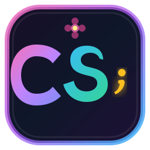

<p align="center">
  
</p>

<h1 align="center">CicekliScript</h1>

<p align="center">
  <strong>Python Simplicity + C Performance</strong><br>
  <em>Modern, Dynamic, Hardware-Accelerated Programming Language</em>
</p>

<p align="center">
  <a href="https://marketplace.visualstudio.com/items?itemName=dorukkdev.cicekliscript"></a>
  <a href="https://marketplace.visualstudio.com/items?itemName=dorukkdev.cicekliscript"></a>
  <a href="https://drkkahraman.github.io/CicekliScript/"></a>
  <a href="LICENSE"></a>
  <a href="https://github.com/drkkahraman/CicekliScript"></a>
</p>

<p align="center">
  <a href="https://marketplace.visualstudio.com/items?itemName=dorukkdev.cicekliscript"><strong> Install from VS Code Marketplace</strong></a> •
  <a href="#-key-features">Features</a> •
  <a href="#-quick-start--installation">Installation</a> •
  <a href="#-interactive-cli-debugger---debug--d">Debugger</a> •
  <a href="#-gpu--tensor-engine-cuda">CUDA & GPU</a> •
  <a href="#-vs-code-extension">VS Code Extension</a> •
  <a href="#-interactive-web-docs--online-ide">Web IDE</a>
</p>

---

**CicekliScript** is a modern, dynamic, and hardware-accelerated programming language that combines Python's high-level syntax, developer friendliness with the raw performance, block structure (`{}`), and speed of C into one language.

---

## Contributors & Developers

- [Doruk Kahraman](https://github.com/drkkahraman)
- [Ali Ege Bozkurt](https://github.com/BrickFPV)
- [Adnan Zafer Binici](https://github.com/ItsBenAdooo)
- [Sarp Kale](https://github.com/sarpkale)

---

##  Documentation & Guides

-  **[Official Online Documentation & Web IDE](https://drkkahraman.github.io/CicekliScript/)**: Complete documentation, live interactive IDE, and searchable API index.
-  **[Windows Installation Guide (docs/WINDOWS_KURULUM.md)](docs/WINDOWS_KURULUM.md)**: Step-by-step setup for Windows (WSL 2 / WSLg / MSYS2).
-  **[Language & Syntax Guide (docs/DIL_REHBERI.md)](docs/DIL_REHBERI.md)**: Detailed syntax rules, data structures, and examples.
-  **[API & Standard Library Reference (docs/API_REFERANSI.md)](docs/API_REFERANSI.md)**: Complete reference of all built-in modules (`math`, `doc`, `cicekli`, `cuda`) and methods.

---

## Main Features

1. **Pure C11 Core**: Interpreter written from scratch in pure C11 without heavy dependencies—lightweight, rock-solid, and fast.
2. **Pythonic Expressiveness**: Dynamic typing, native lists `[1, 2, 3]`, key-value maps `{"key": "value"}`, slicing, and negative indexing (`[-1]`).
3. **Mandatory Semicolon (`;`)**: Clean and unambiguous syntax discipline just like in C and Java.
4. **Rich Standard Library (`cicekli.*` / `ccl.*`)**:
   - `cicekli.input("Prompt")`: Read lines from console
   - `cicekli.println(...)` & `cicekli.print(...)`: Formatted printing
   - `def` and `cicekli.deffunction`: Named functions, first-class values, and closures
5. **Built-in Math & Document/File Modules**:
   - `math.*`: `sqrt`, `pow`, `abs`, `round`, `floor`, `ceil`, `sin`, `cos`, `tan`, `log`, `min`, `max`, `random`
   - `doc.*` & `file.*`: `doc.write`, `doc.add` (append), `doc.read`, `doc.exists`, `doc.delete` with multiple arguments and `\n` newline support
6. **Hardware-Accelerated 2D GUI Engine**:
   - `cicekli.window(width, height, title)` powered by Cairo and X11 with double buffering; live HTML5 Canvas preview on the web.
7. **Flexible Loops**:
   - Python-style: `for (item in list) { ... };`
   - C-style: `for (i = 0; i < 10; i = i + 1) { ... };`
   - While loop: `while (condition) { ... };`
   - `break;` and `continue;` control flow
8. **Multi-Style Comments**: `# Script comment`, `// C++ style single-line`, and `/* C block comment */`.
9. **Interactive Shell (REPL)**: Live evaluation, multi-line blocks, and rich terminal feedback.
10. **Official VS Code Extension (Zero-Setup!)**: Includes the compiled CicekliScript binary directly inside the extension for immediate zero-config coding and one-click system installation.
11. **CUDA & GPU Tensor Acceleration Engine**: Native NVIDIA CUDA acceleration for tensors. PyTorch-like `cicekli.tensor()`, `A.matmul(B)`, `.relu()`, `.sigmoid()`, `.to("cuda")` delivering sub-millisecond execution on GPUs.

---

## Quick Start & Installation

### Linux (Ubuntu / Debian / Arch / Fedora)

Install the required compiler and Cairo/X11 development libraries:

```bash
# Ubuntu / Debian / Mint:
sudo apt update && sudo apt install -y build-essential libcairo2-dev libx11-dev git python3

# Arch Linux:
sudo pacman -S base-devel cairo libx11 git python

# Fedora:
sudo dnf install gcc make cairo-devel libX11-devel git python3
```

Clone the repository and build:

```bash
git clone https://github.com/drkkahraman/CicekliScript.git
cd CicekliScript
make
sudo make install
```

Verify installation:
```bash
ccl --version
```
The output should be: "CicekliScript v1.0.0"

---

### Windows (WSL 2 — Recommended)

On Windows 10/11, open Windows Terminal or PowerShell as **Administrator**:

```powershell
wsl --install
```

After rebooting, open the Ubuntu terminal and follow the Linux instructions above. Thanks to **WSLg**, windows opened with `cicekli.window()` render directly on your native Windows desktop!

> For full Windows details, see **[docs/WINDOWS_KURULUM.md](docs/WINDOWS_KURULUM.md)**.

---

### macOS (Homebrew)

```bash
brew install cairo pkg-config git
git clone https://github.com/drkkahraman/CicekliScript.git
cd CicekliScript
make
sudo make install
```

---

## Usage

>  **Tip**: You can use either the concise **`ccl`** command or the full **`cicekliscript`** command everywhere!

### 1. Interactive REPL Shell
```bash
ccl
```
```text
╔═══════════════════════════════════════════════════╗
║          CicekliScript v1.0.0 REPL                ║
║  Python simplicity + C power + Mandatory ';'      ║
║  To exit: exit(); or cicekli.exit();              ║
╚═══════════════════════════════════════════════════╝

ccl>>> cicekli.println("Hello World!");
Hello World!
ccl>>> a = 15; b = 25;
ccl>>> cicekli.println("Sum:", a + b);
Sum: 40
ccl>>> exit();
```

### 2. Running a Script File
```bash
ccl script.ccl
# or
cicekliscript script.ccl
```

### 3. One-Liner Execution (`-c`)
```bash
ccl -c 'cicekli.println("Square root of 144 is", math.sqrt(144));'
```

### 4. Interactive CLI Debugger (`--debug`, `-d`)
Start the interactive English step debugger directly in your terminal:
```bash
ccl --debug script.ccl
# or
cicekliscript -d script.ccl
```

#### Debugger Commands:
| Command | Alias | Description |
| :--- | :--- | :--- |
| `step` | `s` | Step into the next statement |
| `next` | `n` | Step over to the next statement |
| `finish` | `out` | Step out of the current function |
| `continue` | `c` | Resume execution until next breakpoint |
| `break <line>` | `b <line>` | Set breakpoint at line (e.g. `b 15` or `b test.ccl:15`) |
| `delete <id>` | `del <id>` | Remove breakpoint by ID |
| `breakpoints` | `info b` | List all active breakpoints and hit counts |
| `print <expr>` | `p <expr>` | Evaluate and print expression in current scope |
| `locals` | `info locals` | Inspect all local variables with types and values |
| `backtrace` | `bt`, `stack`| Display call stack frames |
| `list [n]` | `l` | Show source code around current line |
| `help` | `h` | Show help commands |
| `quit` | `q`, `exit` | Terminate debugging session |

### 5. VS Code Native Debugging (`F5` & DAP)
With the CicekliScript extension installed:
- Press **F5** in VS Code to launch the debugger with red-dot breakpoints in the gutter.
- Inspect variables in the sidebar, view call stack, hover to inspect values, and use the step controls toolbar (**F10** Step Over, **F11** Step Into, **Shift+F11** Step Out).
- Or click the **$(debug-alt) Debug** icon in the editor title bar to open the CLI debugger in the terminal!

---

## Syntax Guide

### 1. Variables & Types
CicekliScript uses dynamic typing. Variable assignments must terminate with a semicolon (`;`):
```javascript
name = "Traveler";
version = 1.0;
isActive = true;
nothing = null;

cicekli.println("Name:", name, "| Version:", version, "| Active:", isActive);
```

### 2. Input and Output (I/O)
```javascript
// Printing with / without newline
cicekli.print("Loading... ");
cicekli.println("Done!");

// User input
user = cicekli.input("Enter your name: ");
cicekli.println("Welcome,", user + "!");
```

### 3. Functions (`def` / `cicekli.deffunction`)

#### Named Function:
```javascript
def add(a, b) {
    return a + b;
};

result = add(15, 25);
cicekli.println("15 + 25 =", result);
```

#### Anonymous Function / Closure:
```javascript
square = cicekli.deffunction(x) {
    return x * x;
};

cicekli.println("Square of 6 =", square(6));
```

#### Recursive Function:
```javascript
def fib(n) {
    if (n <= 1) {
        return n;
    }
    return fib(n - 1) + fib(n - 2);
};

cicekli.println("fib(10) =", fib(10));
```

### 4. Conditional Statements (`if`, `elif`, `else`)
```javascript
score = 88;

if (score >= 90) {
    cicekli.println("Grade: A (Excellent)");
} elif (score >= 80) {
    cicekli.println("Grade: B (Good)");
} elif (score >= 70) {
    cicekli.println("Grade: C (Pass)");
} else {
    cicekli.println("Retake required!");
};
```

### 5. Loops

#### Python-Style `for..in`:
```javascript
fruits = ["Apple", "Banana", "Cherry"];
for (f in fruits) {
    cicekli.println("Fruit:", f);
};

// Using range():
for (i in range(5)) {
    cicekli.println("Index:", i);
};
```

#### C-Style `for (init; cond; step)`:
```javascript
total = 0;
for (i = 1; i <= 10; i = i + 1) {
    total = total + i;
};
cicekli.println("Sum 1..10 =", total);
```

#### `while` Loop:
```javascript
countdown = 3;
while (countdown > 0) {
    cicekli.println("T-minus:", countdown);
    countdown = countdown - 1;
};
cicekli.println("Liftoff! 🚀");
```

### 6. Lists, Dictionaries & Strings

- **Lists (Arrays)**:
  ```javascript
  nums = [10, 20, 30, 40];
  nums.append(50);
  last = nums.pop();
  cicekli.println("Length:", nums.len(), "| Last element:", nums[-1]);

  nums.sort();
  nums.reverse();
  cicekli.println("Joined:", nums.join(" -> "));
  ```

- **Dictionaries (Maps)**:
  ```javascript
  dev = {
      "name": "Doruk",
      "lang": "CicekliScript",
      "core": "C11"
  };

  cicekli.println("Dev:", dev.name, "| Language:", dev["lang"]);
  cicekli.println("Keys:", dev.keys());
  ```

- **String Methods**:
  ```javascript
  s = "  CicekliScript Core  ";
  clean = s.trim();
  cicekli.println("Upper:", clean.to_upper());
  cicekli.println("Lower:", clean.to_lower());
  cicekli.println("Split:", clean.split(" "));
  cicekli.println("Contains 'Core':", clean.contains("Core"));
  ```

### 7. Document & File I/O (`doc.*`)
CicekliScript provides a clean file API supporting multiple variables and newline sequences:
```javascript
filename = "report.txt";
author = "Doruk";
score = 98.5;

// Write to file (multi-argument & \n formatting):
doc.write(filename, "=== System Report ===\n", "Author: ", author, "\nScore: ", score, "\n");

// Append new entries:
doc.add(filename, "Status: Success\n", "Year: 2026\n");

// Read and verify:
content = doc.read(filename);
cicekli.println("File content:\n" + content);

// Existence check & deletion:
if (doc.exists(filename)) {
    doc.delete(filename);
    cicekli.println("File cleaned up.");
};
```

---

## ⚡ GPU & Tensor Engine (CUDA)

CicekliScript features a native **NVIDIA CUDA hardware-accelerated tensor engine**:

```javascript
cicekli.println("=== CicekliScript CUDA Engine ===");

if (cicekli.cuda.is_available()) {
    cicekli.println("✓ GPU Device:", cicekli.cuda.device_name());
    mem = cicekli.cuda.memory_info();
    cicekli.println("✓ Free VRAM :", mem.free_mb, "MB / Total:", mem.total_mb, "MB");
};

device = cicekli.cuda.is_available() ? "cuda" : "cpu";

// Create 2x2 tensors
A = cicekli.tensor([
    [1.0, 2.0],
    [3.0, 4.0]
], device);

B = cicekli.tensor([
    [5.0, 6.0],
    [7.0, 8.0]
], device);

// Matrix multiplication (A x B)
C = A.matmul(B);
cicekli.println("Matrix Multiplication (A x B):");
cicekli.println(C);

// Deep Learning Activations and Statistics
cicekli.println("Sum :", C.sum());
cicekli.println("Mean:", C.mean());
```

---

## 📐 2D Graphical User Interface (GUI)

CicekliScript has native support for double-buffered 2D windows powered by Cairo and X11:

```javascript
// Open a 400x300 window:
win = cicekli.window(400, 300, "CicekliScript GUI Demo");

// Background color:
win.color("#1e1e2e");

// Draw text: win.text(text, color, size, x, y);
win.text("CicekliScript GUI", "white", 18, 20, 35);

// Geometric shapes:
win.rect(20, 60, 160, 90, "#313244");
win.circle(280, 105, 40, "#f38ba8");
win.line(20, 200, 380, 200, "#a6e3a1", 3);

// Non-blocking event loop:
win.mainloop();
```

---

## Official VS Code Extension (Visual Studio Marketplace)

[](https://marketplace.visualstudio.com/items?itemName=dorukkdev.cicekliscript)

The official **CicekliScript Extension** is published on the [Visual Studio Marketplace](https://marketplace.visualstudio.com/items?itemName=dorukkdev.cicekliscript) with zero-setup cross-platform support:

- **Bundled Compilers**: Carries native 64-bit Linux (`ccl`) and Windows (`ccl.exe`) compilers directly inside the package—no GCC or Make setup required.
- **Native GUI Support**: Native Win32 GDI windows on Windows and X11/Cairo on Linux, plus a side-by-side **GUI Webview Canvas Preview** button.
- **Native VS Code Debugger (`F5`)**: Full Debug Adapter Protocol (DAP) integration with gutter breakpoints, local variable inspector, watch expressions, and call stack!
- **One-Click Run & REPL**: `Ctrl+F5` shortcut, run buttons in editor title bar, and integrated REPL terminal.
- **Install to System**: Easily install `ccl` to `~/.local/bin/ccl` (Linux/macOS) or `%USERPROFILE%\.cicekliscript\bin\ccl.exe` (Windows) with a single command.

### Installation Methods:
1. **Via VS Code Quick Open (`Ctrl+P`):**
   ```bash
   ext install dorukkdev.cicekliscript
   ```
2. **Via Visual Studio Marketplace Web Page:**
   Install directly with one click from [marketplace.visualstudio.com/items?itemName=dorukkdev.cicekliscript](https://marketplace.visualstudio.com/items?itemName=dorukkdev.cicekliscript).
3. **Via VSIX File:**
   ```bash
   code --install-extension vscode-extension/cicekliscript-1.2.0.vsix
   ```

---

## Interactive Web Docs & Online IDE

Run the built-in documentation server and live playground locally:

## Web Documentation & Local Playground

The official documentation is available globally at **[https://drkkahraman.github.io/CicekliScript/](https://drkkahraman.github.io/CicekliScript/)**.

To run the local documentation server and compiler playground on your own machine:

```bash
python3 server.py
```
Then visit **[http://localhost:6000](http://localhost:6000)** in your browser.

---

## Example Scripts

All examples are located in the `examples/` directory:
- `examples/01_merhaba.ccl`: I/O, variables, and basic operators
- `examples/02_fonksiyonlar.ccl`: Named, anonymous, and mathematical functions
- `examples/03_donguler.ccl`: `for in`, C-style `for`, and `while` loops
- `examples/04_fibonacci.ccl`: Recursive algorithm and execution time benchmarking
- `examples/05_listeler_ve_sozlukler.ccl`: Dynamic arrays, negative indexing, and maps
- `examples/06_hesap_makinesi.ccl`: Functional calculator implementation
- `examples/07_gui_pencere.ccl`: Basic desktop GUI window with Cairo and X11
- `examples/08_gui_gelismis.ccl`: Advanced geometric dashboard and UI components
- `examples/09_gpu_tensor.ccl`: NVIDIA CUDA GPU tensor engine & matrix multiplication benchmark
- `testcodes/test.ccl`: Interactive conversational chatbot (*CicekliBot*)

---

## License

This project is licensed under the MIT License. See the  [LICENSE](LICENSE) for details.
